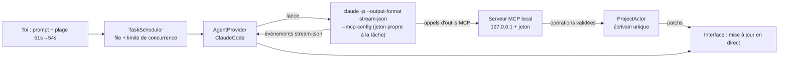

# Analyse de stack — SimpleEffect

> Logiciel de montage vidéo local, piloté par IA (Claude Code CLI d'abord, autres CLI ensuite).
> Document d'analyse rédigé avant tout développement. Les décisions figées sont dans `docs/adr/`.
> Référence technique pour les IA : `docs/architecture.md` (en anglais).

---

## 0. Décisions prises (après tes réponses)

| Sujet | Ta réponse | Conséquence |
|---|---|---|
| OS cibles | Windows + macOS + Linux | **Electron** (même Chromium partout) au lieu de Tauri ; cœur Rust dans un **processus séparé** `se-core` |
| Diffusion | Usage perso | Seule ta session Claude locale est utilisée. Pas de mode clé API pour l'instant (l'abstraction le permettra plus tard) |
| Langue | Code/doc EN, UI FR + i18n | Code, commentaires, CLAUDE.md, docs techniques et ADR en anglais ; interface en français via des clés i18n ; prompts en français |
| Sources | Caméras pro aussi | Le pipeline d'**intermédiaires (mezzanine) et de proxies** arrive tôt (prompt 09) |
| Modifs IA | Direct + annulable | Les modifs s'appliquent en direct ; chaque tâche = un changeset annulable en un clic |
| Export Premiere | Pré-rendus + SRT | FCP7 XML + OTIO ; textes et motion en ProRes 4444 alpha ; sous-titres SRT éditables |
| Features en plus | Les 4 | Sous-titres animés, recadrage auto 9:16, montage par le texte, templates + brand kit |
| Style UI | Moderne épuré, dense | Sombre neutre, une couleur d'accent vive, contrôles compacts |

## 1. Résumé de la stack

| Couche | Choix | Écartés (voir détails) |
|---|---|---|
| Shell desktop | **Electron** (main + preload en TypeScript, sans logique métier) | Tauri 2 (Linux faible), UI native Rust (egui / iced / Slint / GPUI), Qt/C++ |
| Cœur métier | **Rust** dans un processus séparé **`se-core`** (axum : WebSocket RPC + HTTP médias + endpoint MCP), architecture hexagonale | Addon natif napi-rs, Node/TS côté backend |
| Frontend | **React 19 + TypeScript strict + Vite + Tailwind v4 + Radix** | Svelte, Solid, Vue |
| Design system | **`@se/ui`** façon shadcn (code dans le repo, variantes CVA, tokens) + Storybook | MUI, Mantine, Chakra |
| Moteur de rendu | **`@se/engine`** (TS dans le renderer Chromium) : WebCodecs via **Mediabunny** + compositing **PixiJS v8** (WebGL2/WebGPU) + **Web Audio** | Remotion, rendu natif wgpu, MLT, GStreamer |
| Médias | **ffmpeg / ffprobe en sidecar** (processus pilotés par Rust) + **mezzanine/proxies** pour les codecs pro | bindings `ffmpeg-next`, GStreamer |
| Transcription | **whisper.cpp** en sidecar (CUDA sur ta RTX 3080, Metal sur Mac, CPU/Vulkan sinon) | faster-whisper (Python), API cloud |
| Vision locale | **ONNX Runtime** (crate `ort`) pour la détection visage/sujet (recadrage auto) | MediaPipe, OpenCV DNN |
| IA | **`claude -p` en stream-json + serveur MCP local intégré** (crate `rmcp`) | Agent SDK, appel direct de l'API |
| Types partagés | **Rust = source de vérité**, types TS générés (`ts-rs`) | Types écrits deux fois à la main |
| Stockage | Dossier projet : **`project.json` + `project.db` (SQLite) + `cache/`** | Tout-SQLite, CRDT (Loro / Automerge) |
| Unité de temps | **entiers i64 en « flicks »** (1/705 600 000 s) | secondes en flottant |
| Export Premiere | **FCP7 XML** (principal) + **OTIO** ; overlays **ProRes 4444 alpha** ; **SRT** | AAF, EDL, MOGRT |

---

## 2. Ce que le besoin implique techniquement

1. **Prévisualisation temps réel et précise à l'image** (scrub, lecture 30/60 i/s, plusieurs pistes, textes animés) → décodage matériel + compositing GPU.
2. **L'IA doit « voir » et « entendre »** : le CLI Claude ne lit ni la vidéo ni l'audio. Il faut lui fournir une transcription horodatée au mot, une analyse audio (silences, niveaux), des images extraites de la vidéo (Claude est multimodal) et les métadonnées. → pipeline d'analyse locale indispensable.
3. **L'IA agit sans jamais corrompre le projet**, en parallèle de toi et d'autres tâches → elle n'écrit aucun fichier : elle appelle une API d'édition contrôlée (opérations validées, annulables, attribuées à une tâche).
4. **Tout ce que l'IA génère reste ré-éditable** → le résultat est de la *donnée* (un texte avec ses propriétés et keyframes), jamais un rendu figé.
5. **Motion design « complet »** → au-delà de presets simples : modèles d'animation paramétrables générés par l'IA.
6. **Export Premiere** → le modèle de timeline doit coller aux concepts NLE standards (séquences, pistes, clips, points d'entrée/sortie source).
7. **100 % local** → aucune dépendance cloud au runtime. Seules exceptions : le CLI Claude lui-même (qui parle aux serveurs d'Anthropic) et le téléchargement unique de modèles (Whisper, détection de visage), toujours avec ton accord.
8. **Maintenu par des IA** → typage fort de bout en bout, frontières de modules nettes, petits fichiers, documentation contractuelle, tests rapides et déterministes.

---

## 3. Ta machine (constaté)

| Élément | Valeur | Conséquence |
|---|---|---|
| OS | Windows 11 Pro | Plateforme de dev principale ; macOS et Linux supportés par l'architecture |
| CPU / RAM | Ryzen 7 9800X3D, 31 Go | Large marge pour plusieurs agents en parallèle |
| GPU | RTX 3080 (+ iGPU AMD) | Décodage/encodage matériel (NVDEC/NVENC), Whisper accéléré CUDA |
| Claude Code | 2.1.312, connecté | `claude auth status --json` renvoie `loggedIn` : détection de session gratuite et fiable |
| Node / pnpm | 24 / 11 | OK |
| VS Build Tools 2022 | présent | Prérequis Rust (cible MSVC) déjà là |
| **Manquants** | Rust (rustup), ffmpeg, whisper.cpp | Installés aux prompts 01 / 08 / 21, avec ton accord |

---

## 4. Le choix structurant : où vit le moteur de rendu ?

| Option | Pour | Contre |
|---|---|---|
| **A. Rendu natif Rust** (wgpu + ffmpeg) | Perf maximale, tous les codecs | Afficher une surface native *dans* l'UI web est fragile ; moteur texte/animation à écrire de zéro ; incompatible avec un design system type shadcn ; les IA sont moins à l'aise |
| **B. Moteur dans le renderer Chromium** (WebCodecs + WebGL/WebGPU) | Décodage matériel, compositing GPU, **même code pour la preview et l'export (WYSIWYG garanti)**, les LLM excellent en 2D/canvas/animation | Codecs pro (ProRes, DNxHR…) non décodables par Chromium → mezzanine via ffmpeg |
| **C. Remotion** | Vidéo programmatique en React | Rendu par captures de Chrome headless (lent), pas conçu pour un NLE interactif multi-pistes temps réel, licence entreprise au-delà de 3 personnes |
| **D. MLT / GStreamer** (moteurs de Kdenlive, Shotcut, Pitivi) | Éprouvés | Intégration lourde, bindings C, même problème d'affichage dans l'UI web, peu adaptés à une maintenance par IA |

**Décision : B**, avec un pipeline de mezzanine/proxies ffmpeg pour les codecs que Chromium ne sait pas lire. Rust reste central pour tout le reste (projet, médias, analyse, IA, export).

---

## 5. Shell : Electron + cœur Rust séparé

### 5.1 Pourquoi Electron (et plus Tauri)

Tauri s'appuie sur la WebView du système : Chromium sous Windows, mais WebKit sous macOS et surtout **WebKitGTK sous Linux**, où WebCodecs et WebGPU sont incomplets. Comme le moteur de rendu repose sur ces API, il faut le **même Chromium sur les trois OS** → Electron. Le surpoids (~150 Mo) est négligeable pour un logiciel de montage.

### 5.2 Pourquoi un processus Rust séparé plutôt qu'un addon natif

| Critère | Processus `se-core` (choisi) | Addon napi-rs |
|---|---|---|
| Robustesse | Un crash du cœur ne ferme pas l'UI ; redémarrage automatique | Un crash natif tue le processus main |
| Testabilité | Le cœur se lance et se teste seul (sans Electron) | Nécessite Node pour tester |
| Serveurs HTTP | Naturel : RPC WebSocket, médias avec Range, endpoint MCP au même endroit | Possible mais à greffer dans l'addon |
| Indépendance du shell | L'UI parle au cœur par WebSocket, quel que soit le shell | Couplé à Node/Electron |
| Latence | < 1 ms en local, suffisant | Plus faible, sans intérêt ici |

Le processus main d'Electron reste minuscule : fenêtres, menus, dialogues natifs, lancement et supervision de `se-core`, transmission de l'adresse et du jeton du cœur au renderer.

---

## 6. Moteur de rendu `@se/engine`

```
Document projet (données)
      │
      ▼
evaluate(sequence, t) ── fonction pure ──► FrameGraph (calques résolus : transform, opacité, keyframes interpolées)
      │
      ├─► Décodage    : Mediabunny + WebCodecs (matériel), cache LRU de frames, préchargement
      ├─► Compositing : PixiJS v8 (WebGL2, WebGPU optionnel) derrière une interface `Compositor`
      └─► Audio       : Web Audio, ordonnanceur avec anticipation, horloge maître = AudioContext
```

- **Preview** : rendu temps réel dans le viewer ; proxies basse résolution activables pour la 4K et les codecs lourds.
- **Export** : *le même pipeline* exécuté hors temps réel dans un Web Worker (OffscreenCanvas) → `VideoEncoder` (NVENC / VideoToolbox via Chromium) → mux MP4 par Mediabunny → octets streamés vers `se-core` qui écrit le fichier. L'export tourne **pendant que tu continues à monter**. Pour ProRes/DNxHR en sortie : frames envoyées à ffmpeg.
- **Mediabunny** : licence MPL-2.0 → utilisable librement comme dépendance.
- **PixiJS** : renderer 2D GPU très rapide (vidéo, texte, formes, masques, filtres, modes de fusion), fonctionne en Worker, très bien connu des LLM. Caché derrière une interface pour rester remplaçable.

---

## 7. Pipeline médias (Rust + ffmpeg en sidecar)

- **Import** : `ffprobe` → métadonnées. Le renderer vérifie avec `VideoDecoder.isConfigSupported()` si Chromium sait décoder le codec sur *cette* machine (dépend du GPU et de l'OS).
- **Codecs pro** (ProRes, DNxHR, XAVC 10 bits 4:2:2, MPEG-2…) : ffmpeg génère automatiquement
  - une **mezzanine** haute qualité décodable par Chromium (sert à la preview pleine qualité et à l'export) ;
  - un **proxy** basse résolution pour une lecture fluide.
  L'export Premiere pointe toujours vers les **fichiers originaux**.
- **RAW propriétaires** (BRAW, R3D, ARRIRAW) : hors périmètre au départ, car ils exigent les SDK des constructeurs (ffmpeg ne les décode pas). Contournement : transcoder dans DaVinci Resolve avant import.
- **Tâches de fond** (file de jobs à priorités, progression en direct, annulation, cache par empreinte de contenu) : bande de miniatures, pics de waveform multi-résolution, analyse audio (silences, loudness LUFS), détection de changements de plan, mezzanine/proxies, transcription, détection de visages.
- **Service des fichiers au renderer** : routes HTTP de `se-core` avec requêtes Range.
- **Pourquoi des processus ffmpeg plutôt que des bindings** : compilation triviale sur les 3 OS, un crash ffmpeg ne fait pas tomber l'app, binaires remplaçables, code plus lisible pour une IA.

---

## 8. Intégration IA (le cœur du produit)

### 8.1 Principe : l'IA n'écrit jamais de fichiers, elle appelle des outils



`se-core` embarque un **serveur MCP local** (protocole standard d'outils pour agents IA). Chaque tâche reçoit un jeton qui la lie à sa **portée** (plage temporelle, pistes). Chaque appel d'outil devient une opération sur le projet : validée, appliquée par un **acteur unique** (aucune corruption possible), journalisée, annulable et attribuée à la tâche.

### 8.2 Abstraction générique multi-IA

Trait Rust `AgentProvider` : `detect()`, `auth_status()`, `capabilities()`, `start(spec) → flux d'AgentEvent + annulation`.
Claude Code est le premier adaptateur. Comme les outils passent par MCP — standard supporté par les principaux CLI (Gemini CLI, Codex CLI, etc.) — ajouter une autre IA revient à écrire **un adaptateur** (comment lancer le CLI et parser sa sortie), sans toucher aux outils.

### 8.3 Invocation de Claude Code (flags vérifiés sur ta version 2.1.312)

```bash
claude -p "<prompt>" \
  --output-format stream-json --verbose \
  --mcp-config '<json>' --strict-mcp-config \
  --tools "" --allowedTools "mcp__simpleeffect__*" \
  --permission-prompts none \
  --append-system-prompt "<règles de montage + contexte>" \
  --model <alias> --effort <niveau> \
  --session-id <uuid>        # puis --resume <uuid> pour itérer sur la même tâche
```

- `--tools ""` désactive tous les outils natifs (Bash, Edit…) : l'agent ne peut agir **que** via nos outils.
- Le processus tourne dans un dossier de travail vide dédié, pour ne charger aucun `CLAUDE.md` de projet.
- **Détection de session** : `claude auth status --json` → `loggedIn`. Si `false` : bandeau « lance `claude` dans un terminal puis `/login` », et les fonctions IA sont désactivées.
- Annulation : arrêt de l'arbre de processus. Sous Windows, `claude` est un shim `.cmd` → résolution via PATHEXT + chemin configurable dans les réglages.
- Ces comportements seront revalidés empiriquement au prompt 17, et couverts par des tests de rejeu (sortie stream-json enregistrée) pour ne jamais dépendre d'un vrai appel dans les tests.

### 8.4 Comment l'IA « voit » et « entend »

Outils de lecture exposés en MCP : résumé du projet, contenu de la timeline sur une plage, transcription au mot, analyse audio (silences, niveaux), **images extraites à des instants donnés** (renvoyées comme images, Claude les regarde), changements de plan, liste des médias, brand kit.

### 8.5 Parallélisme et conflits

- Chaque tâche a une **portée** ; les outils d'écriture refusent toute modification hors portée, avec un message explicite pour que l'agent se corrige.
- **Écrivain unique** : toutes les modifications (toi, tâche 1, tâche 2…) passent par le même acteur, sérialisées.
- **Concurrence optimiste** : chaque élément a une révision ; si tu as modifié un élément depuis que l'agent l'a lu, l'écriture est refusée et l'agent relit.
- **Changeset par tâche, appliqué en direct** (ton choix) : les modifs apparaissent pendant que l'IA travaille ; toutes celles d'une tâche forment un bloc annulable d'un coup, même si tu as fait autre chose entre-temps.
- Interface : zone colorée « IA en cours » sur la timeline, panneau des tâches avec journal en direct, coût estimé, annulation, relance.
- Limite de concurrence configurable (défaut : 3 agents simultanés).

### 8.6 Ré-édition

Chaque élément créé par l'IA est une donnée normale marquée `origin: tâche X`. Tu le modifies dans l'inspecteur comme n'importe quel élément, ou tu demandes « refais ça » : la session Claude de la tâche est reprise (`--resume`) avec tout son contexte.

### 8.7 Motion design : deux niveaux

1. **Calques déclaratifs** : texte, formes, images, vidéo + keyframes + courbes d'easing + bibliothèque de presets (fondu, glissé, pop, machine à écrire…). 100 % éditable dans l'inspecteur.
2. **Modèles de motion** : pour les animations complexes, l'IA écrit un module (`render(ctx, t, params)`) accompagné d'un **schéma de paramètres**. L'inspecteur génère automatiquement les contrôles (texte, couleurs, durées…) depuis ce schéma : tu ré-édites sans toucher au code. Exécution isolée dans un Worker sans accès au système. Sauvegardables dans une bibliothèque réutilisable avec ton brand kit — l'équivalent des MOGRT de Premiere, mais générés par l'IA.

### 8.8 Point d'attention : conditions d'utilisation d'Anthropic

- **Usage personnel (ton cas)** : le logiciel lance ton binaire `claude` non modifié avec ta propre session, et ne lit ni ne stocke jamais tes identifiants. C'est le cas « utilisateur final » ; les règles d'Anthropic visent les développeurs qui intègrent le login Claude.ai dans *leurs* produits.
- **Si un jour tu distribues** : la page légale de Claude Code indique qu'Anthropic n'autorise pas les développeurs tiers à proposer le login Claude.ai dans leurs applications. Il faudrait alors ajouter un mode clé API et valider avec Anthropic.
- **Quotas** : chaque tâche parallèle consomme ton quota. D'après VentureBeat (mai 2026), l'usage `claude -p` serait décompté sur un crédit « Agent SDK » distinct ; je n'ai pas trouvé de page officielle qui le confirme. L'app affichera le coût estimé renvoyé par le CLI pour chaque tâche.

---

## 9. Modèle de données et stockage

### 9.1 Le temps

Tous les instants et durées sont des **entiers i64 en flicks** (1 seconde = 705 600 000 flicks). Cette base divise exactement 23,976 / 24 / 25 / 29,97 / 30 / 50 / 59,94 / 60 / 120 i/s et 44,1 / 48 / 96 kHz : aucune erreur d'arrondi, jamais de dérive. Conversion en secondes ou en timecode uniquement aux frontières (affichage, outils IA, export). Côté TypeScript, ces valeurs restent des `number` exacts jusqu'à ~147 jours de durée.

### 9.2 Le document

```
Project
├─ assets[]        médias importés (chemin original, métadonnées, analyses, mezzanine/proxy)
├─ sequences[]     une séquence = un format (1920×1080, 1080×1920…) + des pistes
│  └─ tracks[]     vidéo / audio
│     └─ items[]   MediaClip | Text | Shape | Image | MotionTemplate | Caption
│                  propriétés animables (valeur fixe ou keyframes + easing)
│                  origin : user | ai_task(id)
├─ templates[]     modèles de motion du projet
└─ brandKit        polices, couleurs, logo, style de sous-titres par défaut
```

Un projet peut contenir plusieurs séquences : par exemple une version 16:9 et une version 9:16 dérivée par recadrage auto.

### 9.3 Opérations, historique, changesets

Toute modification est une **opération** (ajouter, déplacer, rogner, couper, ripple-delete, insérer un blanc, modifier une propriété…) qui produit son inverse. Les opérations sont groupées en transactions (annuler/rétablir) et en changesets par tâche IA.
Un CRDT (Loro, Automerge) a été écarté : sur une seule machine avec un écrivain unique, il apporterait de la complexité sans bénéfice.

### 9.4 Sur disque

```
MonProjet.seproj/
├─ project.json     document canonique, versionné (migrations), écrit de façon atomique
├─ project.db       SQLite : journal d'opérations (reprise après crash), tâches IA + journaux,
│                   transcriptions (recherche plein texte FTS5), analyses
├─ cache/           dérivés régénérables : mezzanines, proxies, miniatures, waveforms, rendus d'overlays
└─ exports/
```

- Les médias sont **référencés** (pas copiés), avec une fonction « rassembler les médias » et une fonction de reliaison si un fichier a bougé.
- Données de l'application (bibliothèque de projets, réglages, configuration des IA, templates globaux, brand kits, modèles ML) : `%APPDATA%\SimpleEffect` (Windows), `~/Library/Application Support/SimpleEffect` (macOS), `~/.local/share/SimpleEffect` (Linux).

---

## 10. Export

- **Rendu vidéo** : moteur hors temps réel → MP4 H.264 / HEVC / AV1 (encodage matériel). Préréglages YouTube, TikTok, Reels, Shorts. ProRes via ffmpeg.
- **Premiere Pro** :
  - **FCP7 XML** (format principal) : importé par Premiere depuis toujours et le plus mature (pistes, clips, in/out, niveaux audio, opacité, position/échelle, fondus enchaînés).
  - **OTIO** en complément : supporté en import/export par Premiere 26.0 (janvier 2026) d'après les notes de version d'Adobe, et par DaVinci Resolve. Des utilisateurs signalent encore des pertes (noms de clips notamment), d'où le choix de FCP7 XML comme format principal.
  - Médias → **fichiers originaux**. Textes et motion → **clips ProRes 4444 avec transparence** sur les pistes supérieures. Sous-titres → **SRT**, importés comme légendes **éditables**.
- **Limite connue** : les textes animés ne seront pas éditables nativement dans Premiere (ils arrivent pré-rendus). Seuls les sous-titres le restent.

---

## 11. Design system `@se/ui`

- **Principes shadcn** : le code des composants vit dans le repo, composition, variantes via CVA, thème par tokens CSS. Primitives accessibles Radix, **encapsulées** : l'app n'importe jamais Radix directement.
- **Style « moderne épuré, dense »** : sombre neutre, une couleur d'accent vive, typo soignée (Inter + JetBrains Mono embarquées, aucun CDN), contrôles de 24–28 px, chiffres tabulaires pour les timecodes, couleurs sémantiques par type (vidéo, audio, texte/graphique, sous-titres, IA).
- **Inventaire** :
  - *Primitives* : Button, IconButton, Input, Select, Slider, Switch, Checkbox, Tooltip, Popover, Dialog, DropdownMenu, ContextMenu, Tabs, ToggleGroup, ScrollArea, Kbd, Badge, Toast, Progress.
  - *Composants montage* : Panel, Dock redimensionnable, Toolbar, PropertyRow/PropertyGroup (inspecteur), **ScrubInput** (valeur modifiable en glissant, comme dans After Effects), TimecodeInput, ColorField, éditeur de courbe d'easing, bouton keyframe (losange), barre de transport, VU-mètre, Ruler, Playhead, TrackHeader, ClipShell, sélecteur de format, AiTaskCard, PromptComposer avec puces de timecode.
- **Storybook** : chaque composant a ses stories (documentation vivante pour toi et pour les IA) et des tests d'accessibilité.

---

## 12. Qualité et maintenabilité par des IA

- **Types partagés générés** : les types Rust produisent automatiquement les types TypeScript. Aucune duplication manuelle.
- **Architecture hexagonale** : `se-domain` pur (sans entrée/sortie) → `se-app` (cas d'usage + interfaces) → adaptateurs (stockage, ffmpeg, whisper, vision, IA, MCP, export). `se-core` assemble le tout.
- **Règles de taille** : fichiers courts, une responsabilité par module, noms explicites.
- **Contexte pour les IA** : `CLAUDE.md` racine concis + un `CLAUDE.md` par crate/package (Claude Code les charge automatiquement quand il travaille dans le dossier) + ADR pour chaque décision + `prompts/PROGRESS.md` comme journal de bord entre les sessions.
- **Tests** : propriétés (proptest) sur les invariants de timeline, snapshots (insta) des exports XML/OTIO et des schémas d'outils MCP, faux provider IA qui rejoue une sortie stream-json enregistrée, tests « golden frame » du rendu.
- **Lint strict** : clippy `-D warnings`, rustfmt, ESLint strict (typescript-eslint, react-hooks, frontières entre features), Prettier, TypeScript `strict`.

---

## 13. Risques principaux et parades

| Risque | Impact | Parade |
|---|---|---|
| Lecture fluide multi-pistes 4K | Élevé | Proxies, cache de frames, décodage matériel, profilage dès le prompt moteur |
| Synchronisation audio/vidéo | Moyen | Horloge maître audio, tests dédiés |
| Codecs caméra pro | Moyen | Mezzanine + proxies automatiques à l'import |
| Changement de flags ou de format du CLI Claude | Moyen | Adaptateur isolé, détection de version, tests de rejeu |
| Quotas d'usage avec plusieurs tâches en parallèle | Moyen | Limite de concurrence, affichage du coût par tâche |
| Fidélité de l'import dans Premiere | Moyen | Snapshots XML + checklist d'import manuel |
| Exécution de code généré par l'IA (modèles de motion) | Moyen | Sandbox Worker sans accès réseau, IPC ni système de fichiers |
| Différences GPU/codecs entre OS | Moyen | Détection des capacités au runtime, repli sur mezzanine |

---

## 14. Prérequis à installer

- **rustup** (toolchain stable) — prompt 01
- **ffmpeg / ffprobe** par OS, embarqués comme sidecars via `pnpm fetch-binaries` — prompt 08
- **whisper.cpp** (CUDA / Metal / CPU) + modèle `large-v3-turbo` (~1,6 Go), téléchargé une fois avec ton accord ou importé à la main — prompt 21
- **Modèle ONNX de détection de visage** (quelques Mo) — prompt 26

---

## 15. Feuille de route

Le développement est découpé en 30 prompts ordonnés dans `prompts/` (voir `prompts/README.md`).

---

## Sources

- [Adobe — notes de version Premiere (OTIO en 26.0)](https://helpx.adobe.com/premiere-pro/kb/fixed-issues.html)
- [Adobe Community — OTIO import/export disponible](https://community.adobe.com/announcements-732/now-released-otio-import-and-export-311699)
- [Mediabunny — introduction](https://mediabunny.dev/guide/introduction)
- [MDN — WebCodecs API](https://developer.mozilla.org/Web/API/WebCodecs_API)
- [Claude Code — Legal and compliance](https://code.claude.com/docs/en/legal-and-compliance)
- [Claude Agent SDK — overview](https://code.claude.com/docs/en/agent-sdk/overview)
- [VentureBeat — crédit Agent SDK (13 mai 2026)](https://venturebeat.com/ai/anthropic-reinstates-openclaw-and-third-party-agent-usage-on-claude-subscriptions-with-a-catch/)
