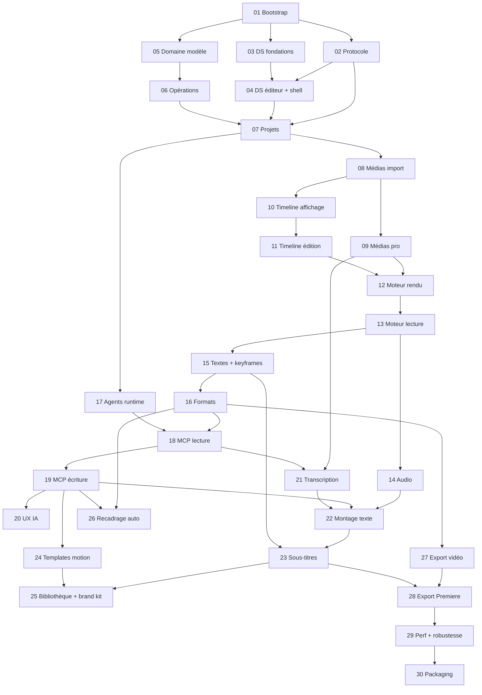

# Feuille de route — prompts

Chaque fichier `NN-*.md` décrit **une** fonctionnalité, avec son contexte, son périmètre, ses critères d'acceptation et ses tests. Les prompts sont pensés pour être exécutés **dans l'ordre**, un par session Claude Code.

## Comment lancer un prompt

1. Ouvre une **nouvelle session** Claude Code à la racine du repo (un contexte neuf par prompt).
2. Tape simplement :
   ```
   lance le prompt 01
   ```
3. Claude crée une branche `feature/NN-…` depuis `dev` à jour, lit `CLAUDE.md`, la doc et le prompt, puis développe. S'il te pose une question (installation, téléchargement, choix produit), réponds-lui.
4. À la fin, il coche le prompt ci-dessous, ajoute une entrée dans `PROGRESS.md`, pousse sa branche, la fusionne dans `dev` (sans PR) puis la supprime de GitHub.
5. Toi, tu testes, puis tu promeus `dev` → `recette` → `main` et tu lances les releases : voir [`GUIDE-GIT.md`](../GUIDE-GIT.md).

**Si un prompt est trop gros pour une session**, Claude s'arrête à un point cohérent et note ce qui reste dans `PROGRESS.md`. Relance alors : `Continue le prompt prompts/NN-....md`.

## Conseils

- **Modèle** : le plus capable (effort élevé) pour les fondations **01, 05, 06, 07** et les prompts marqués ⚠️ ; un modèle plus économique suffit pour les autres. Une erreur dans les fondations coûte cher plus tard.
- **Reste présent** sur les prompts qui te demanderont quelque chose : 01 (installation de Rust), 03 (choix de la couleur d'accent), 08 (téléchargement de ffmpeg), 17 (vrais appels `claude -p`, qui consomment un peu de quota), 21 (binaires et modèle Whisper), 26 (modèle de détection de visages), 28 (test d'import dans Premiere).
- **Teste entre deux prompts** : `pnpm dev` et deux minutes de clic. Un bug repéré tout de suite coûte bien moins de tokens qu'un bug découvert trois prompts plus tard.
- **Reste séquentiel** : deux sessions en parallèle modifient toutes les deux ce fichier et `PROGRESS.md`, d'où des conflits de fusion.
- **Jalons pour une pré-release** (promotion vers `recette` puis tag `-rc`, voir `GUIDE-GIT.md`) : après 04 (shell visible), 13 (lecture vidéo), 16 (montage de base complet), 20 (IA utilisable), 28 (exports).
- **Session coupée ou contexte saturé** : relance `Continue le prompt prompts/NN-….md`. Claude reprend la branche `feature/NN-…` et lit `PROGRESS.md`.

## Ajouter une fonctionnalité plus tard

Copie `_TEMPLATE.md` en `NN-ma-feature.md`, remplis-le, ajoute-le au tableau ci-dessous. Les idées en attente sont dans `docs/backlog.md`.

## Prompts

| ✓ | # | Prompt | Dépend de | Parallélisable avec |
|---|---|---|---|---|
| **Phase 0 — Fondations** |||||
| [x] | 01 | [Bootstrap du monorepo](01-bootstrap-monorepo.md) | — | — |
| [x] | 02 | [Protocole typé et couche RPC](02-protocole-rpc.md) | 01 | 03, 05 |
| [x] | 03 | [Design system : fondations](03-design-system-fondations.md) | 01 | 02, 05, 06 |
| [x] | 04 | [Design system : composants montage, shell, i18n](04-design-system-editeur-shell.md) | 02, 03 | 05, 06 |
| **Phase 1 — Domaine et projets** |||||
| [x] | 05 | [Domaine : temps et modèle de document](05-domaine-modele.md) | 01 | 02, 03, 04 |
| [x] | 06 | [Domaine : opérations, historique, changesets](06-domaine-operations.md) ⚠️ | 05 | 03, 04 |
| [x] | 07 | [Persistance et gestion des projets](07-persistance-projets.md) | 02, 04, 06 | — |
| **Phase 2 — Médias** |||||
| [ ] | 08 | [Médias 1 : import, bin, jobs, miniatures, waveforms](08-medias-import.md) | 07 | 17 |
| [ ] | 09 | [Médias 2 : codecs pro, mezzanines, proxies, analyses](09-medias-pro-analyses.md) | 08 | 10, 17 |
| **Phase 3 — Montage** |||||
| [ ] | 10 | [Timeline A : affichage et navigation](10-timeline-affichage.md) | 08 | 09, 17 |
| [ ] | 11 | [Timeline B : édition](11-timeline-edition.md) | 10 | 17 |
| [ ] | 12 | [Moteur A : évaluation, décodage, compositing, viewer](12-moteur-rendu.md) ⚠️ | 09, 11 | 17 |
| [ ] | 13 | [Moteur B : lecture temps réel, audio, synchro A/V](13-moteur-lecture.md) ⚠️ | 12 | 17 |
| [ ] | 14 | [Édition audio, transitions, blancs](14-edition-audio.md) | 13 | 15, 17 |
| [ ] | 15 | [Textes, graphiques et keyframes](15-textes-keyframes.md) ⚠️ | 13 | 14, 17 |
| [ ] | 16 | [Formats, séquences multiples, safe areas](16-formats-sequences.md) | 15 | 17 |
| **Phase 4 — IA** |||||
| [ ] | 17 | [Runtime des agents IA (générique + Claude Code)](17-agents-runtime.md) ⚠️ | 07 | 08 → 16 |
| [ ] | 18 | [Serveur MCP : outils de lecture](18-mcp-lecture.md) | 16, 17 | 21 |
| [ ] | 19 | [Serveur MCP : outils d'écriture, portée, changesets](19-mcp-ecriture.md) ⚠️ | 18 | 21 |
| [ ] | 20 | [UX IA : composeur, tâches parallèles, annulation](20-ux-ia.md) | 19 | 21 |
| **Phase 5 — Transcription et audio intelligent** |||||
| [ ] | 21 | [Transcription locale (whisper.cpp)](21-transcription.md) | 09, 18 | 19, 20 |
| [ ] | 22 | [Montage par le texte et coupes intelligentes](22-montage-texte.md) | 14, 19, 21 | — |
| [ ] | 23 | [Sous-titres automatiques animés](23-sous-titres.md) | 15, 22 | 24 |
| **Phase 6 — Motion design avancé** |||||
| [ ] | 24 | [Modèles de motion générés par l'IA](24-templates-motion.md) ⚠️ | 19 | 23 |
| [ ] | 25 | [Bibliothèque de templates et brand kit](25-bibliotheque-brand-kit.md) | 23, 24 | 26 |
| [ ] | 26 | [Recadrage automatique 16:9 → 9:16](26-recadrage-auto.md) | 16, 19 | 25 |
| **Phase 7 — Export** |||||
| [ ] | 27 | [Export vidéo (rendu final)](27-export-video.md) ⚠️ | 16 | 21 → 26 |
| [ ] | 28 | [Export Premiere Pro](28-export-premiere.md) ⚠️ | 23, 27 | — |
| **Phase 8 — Finition** |||||
| [ ] | 29 | [Performance et robustesse](29-performance-robustesse.md) | 28 | — |
| [ ] | 30 | [Packaging multi-plateforme](30-packaging.md) | 29 | — |

« Parallélisable » signifie : peut être développé dans une session séparée (idéalement sur une branche ou un worktree séparé) sans toucher aux mêmes fichiers. En cas de doute, reste séquentiel.

## Graphe des dépendances


